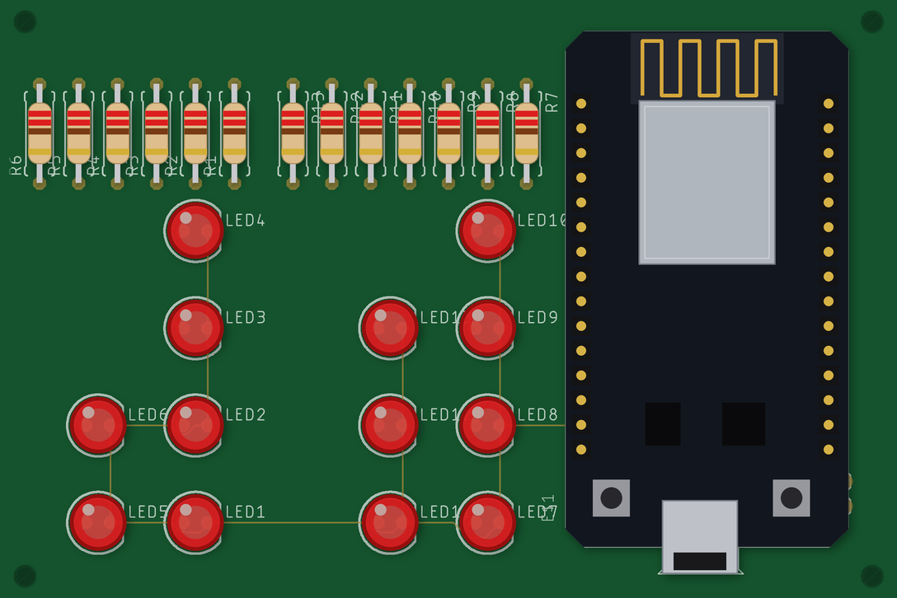

# Binary Clock

A WiFi-connected binary clock built around an ESP32. It syncs the time over NTP
and shows it on a grid of red LEDs, on a custom 90 × 60 mm two-layer PCB.

*Preview of the assembled board: 13 red LEDs, 13 resistors and an ESP32 DevKit
plugged into the socket. The image is a rendering built from the Gerber files,
not a photo.*

## Hardware

| Qty | Part | Notes |
|----:|------|-------|
| 1 | [ESP32-WROOM-32 DevKit V1 (30 pin, 4 MB)](https://www.otronic.nl/nl/esp32-wroom-4mb-devkit-v1-board-met-wifi-bluetooth-en-dual-core-processor) | plugs into the two 15-pin rows on the right of the board |
| 13 | 5 mm red LED, through-hole | LED1 – LED13 |
| 13 | Through-hole resistor, 10.16 mm (0.4") pitch | R1 – R13. The files don't give a value; 220 Ω is a typical choice for red LEDs on 3.3 V |
| 2 | 2-pin jumper pads | J1 / J2 near the bottom-right corner |

## PCB

Everything needed to order or redraw the board is in [`pcb/`](pcb/):

- `CAMOutputs.rar`: Gerber and drill files exported from EAGLE 9.6.2 (2 layers, 1.57 mm, 90 × 60 mm).
- `pcb-preview.png`: the picture above.

**To order:** unpack the archive, zip the `GerberFiles` and `DrillFiles` folders
together, and upload the zip to a PCB service such as
[JLCPCB](https://jlcpcb.com/). Choose 2 layers and 1.6 mm thickness.

**To redraw:** the Gerbers open in any viewer (e.g. KiCad's Gerber Viewer or
`gerbv`), and the silkscreen carries all the reference designators and ESP32 pin
labels.

## Firmware

The firmware is a [PlatformIO](https://platformio.org/) project using the Arduino
framework.

1. Copy `src/secrets.h.example` to `src/secrets.h` and fill in your WiFi
   name and password (`secrets.h` is gitignored).
2. Set `TIMEZONE` in `src/main.cpp` to your
   [POSIX timezone string](https://github.com/nayarsystems/posix_tz_db).
3. Connect the ESP32 over USB and run `pio run -t upload`.
4. Watch it with `pio device monitor` (115200 baud).

While it connects to WiFi, all LEDs flash. Once the time is synced, the LEDs
cycle through hour, minute and second, 2 seconds each, as a binary number.

> **Work in progress:** `LED_PINS` in `src/main.cpp` is a placeholder for 8 LEDs.
> It has not yet been matched to the GPIOs on this 13-LED board.

## Development container

`.devcontainer/` contains a VS Code dev container with PlatformIO. The ESP32 is
passed through to the container with `--device=/dev/ttyUSB0`, so plug the board
in before starting the container.
